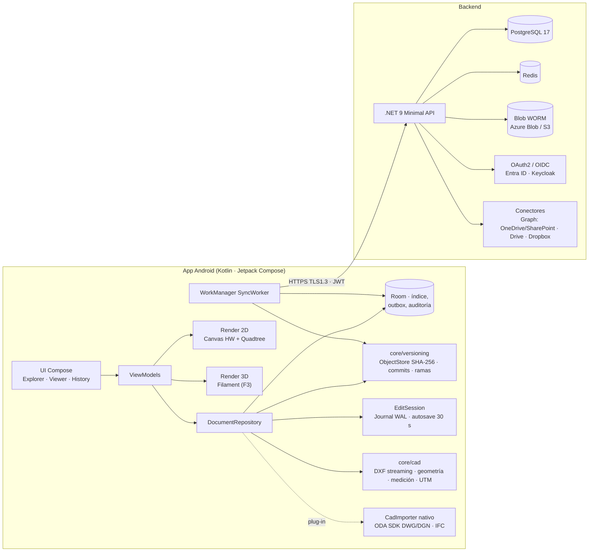
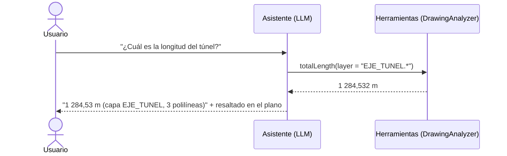

# 03 · Arquitectura técnica

## 1. Visión general

## 2. Módulos del repositorio

| Módulo | Tipo | Responsabilidad | Dependencias |
|---|---|---|---|
| `android/core/cad` | Kotlin/JVM puro | Modelo CAD, parser/escritor DXF, teselado, quadtree, mediciones, UTM/Helmert, análisis | Ninguna |
| `android/core/versioning` | Kotlin/JVM puro | ObjectStore, commits, ramas, fusión 3 vías, Journal WAL, EditSession, retención | kotlinx-serialization |
| `android/app` | Android | UI Compose, Room, WorkManager, cifrado Keystore, exportación, sync | core/* (composite build) |
| `backend/CadField.Api` | .NET 9 | Sync diferencial, refs CAS, blobs, auditoría, permisos | EF Core Npgsql, Redis, JwtBearer |

El núcleo es **independiente de Android**: se prueba en cualquier JVM (`./gradlew -p core test`), puede reutilizarse en un futuro cliente de escritorio (Compose Multiplatform) o en el servidor (análisis por lotes).

## 3. Capas y patrones

- **Clean Architecture ligera**: UI → ViewModel (estado inmutable `StateFlow`) → Repository → fuentes (Room, ObjectStore, red).
- **Offline-first**: la fuente de verdad es local; la nube es réplica. Toda escritura va a outbox.
- **Event sourcing local**: cada edición es una `EditOp` en el journal; el estado es `snapshot + replay(journal)`.
- **Content-addressable storage**: originales, snapshots, commits y multimedia son objetos SHA-256 inmutables (deduplicación + integridad verificable + sincronización diferencial trivial).
- **Plug-ins de formato**: interfaz `CadImporter` para motores nativos (JNI) sin acoplar el núcleo.

## 4. Evaluación de motores CAD

| Motor | Formatos | Licencia | Fidelidad DWG | Android | Veredicto |
|---|---|---|---|---|---|
| **ODA Drawings SDK** (sucesor de Teigha) | DWG/DXF R12–2018+, DGN, DWF (módulo) | Comercial (membresía ODA anual) | Muy alta, estándar de la industria | Sí (ARM64, NDK) | **Elegido para DWG/DGN** en Enterprise |
| Teigha | = versiones antiguas de ODA | Comercial | Alta | Sí | Obsoleto como marca; usar ODA |
| LibreDWG | DWG lectura (parcial en versiones recientes) | **GPLv3** | Media | Compilable | **Descartado** para app cerrada (obligaría a liberar el código). Útil sólo en herramienta interna/servidor aislado |
| OpenCascade (OCCT) | STEP, IGES, BREP (no DWG) | LGPL 2.1 + excepción | n/a | Sí | Para 3D sólido/STEP en F4 |
| Parser DXF propio | DXF ASCII | Propio | Alta en entidades soportadas | Sí (JVM) | **MVP** — implementado |
| web-ifc / IfcOpenShell | IFC2x3/IFC4 | MPL-2.0 / LGPL | n/a | WASM/NDK | BIM en F3 |

**Decisión (ADR-001):** MVP con DXF propio (cero costo de licencia, control total, verificable). DWG nativo mediante ODA en Enterprise, encapsulado tras `CadImporter`, ejecutado en proceso aislado (`:cadengine`) para que un fallo nativo no tumbe la app ni la sesión de edición.

## 5. Render

| Opción | Uso | Notas |
|---|---|---|
| Canvas Android acelerado por HW (`drawLines` hairline) | **2D MVP** | Sin teselado de trazo; quadtree + LOD; textos en espacio de pantalla |
| OpenGL ES 3.x | 2D F2 (planos > 5 M segmentos) | VBO por capa, *instancing* de bloques, MSAA |
| Filament (Google) | **3D F3** | PBR, glTF nativo, modos sombreado/realista/transparente; *clipping planes* para cortes |
| Vulkan | F4 opcional | Sólo si perfiles muestran cuello de botella en GLES |

**Precisión numérica:** coordenadas UTM (~10⁶–10⁷ m) en `float32` pierden ~0,5–1 m. Se almacena geometría relativa al origen del dibujo y la traslación se compone en `double` (`RenderModel.origin`).

## 6. Rendimiento para archivos grandes (DWG 500 MB / DXF 1 GB)

1. **Streaming**: el parser lee pares de grupo con `BufferedReader` de 64 KB; nunca carga el archivo en memoria.
2. **Carga por capas**: `DxfParser(layerFilter = …)` permite abrir sólo capas seleccionadas (p.ej. eje + sostenimiento).
3. **Renderizado progresivo**: el teselado corre en `Dispatchers.Default`; F2 publica lotes de 50 k entidades para pintar mientras carga.
4. **Caché de teselado**: F2 serializa `RenderModel` por `originalHash` → reaperturas en < 3 s.
5. **Bajo demanda**: bloques (INSERT) se expanden sólo si son visibles; LOD omite entidades subpíxel.
6. **Memoria**: `FloatArray` por entidad; objetivo ≤ 1,5× geometría; `largeHeap` y modo "sólo capas visibles" en gama baja.

## 7. Inteligencia artificial

- **Análisis CAD determinista** (`DrawingAnalyzer`): duplicados, longitudes cero, polilíneas casi cerradas, bloques inexistentes. Corre offline.
- **Asistente técnico**: un LLM (en la nube, opcional, con consentimiento) traduce lenguaje natural a llamadas de herramientas (`totalLength`, `closedArea`, `countBlocks`, `countByLayer`). **El LLM nunca calcula cifras**: sólo orquesta funciones verificables y cita capa/entidades. Se envían metadatos (nombres de capas, conteos), no el plano completo, salvo autorización.
- F4: modelo on-device (cuantizado) para clasificación de capas y reconocimiento de símbolos en planos PDF raster.

## 8. Seguridad

| Control | Implementación |
|---|---|
| Autenticación | OAuth2/OIDC (Authorization Code + PKCE) contra IdP corporativo; JWT de corta duración + refresh |
| Autorización | Roles por proyecto (Viewer, Editor, Reviewer, Admin) verificados en cada endpoint |
| Cifrado en tránsito | TLS 1.3; *certificate pinning* opcional en Enterprise |
| Cifrado en reposo (móvil) | AES-256-GCM con clave no exportable en Android Keystore / StrongBox (`CryptoManager`) |
| Cifrado en reposo (servidor) | Cifrado de disco/Blob (SSE) + PostgreSQL TDE del proveedor |
| Firma digital | ECDSA P-256 por dispositivo sobre cada commit y PDF; clave pública registrada en servidor |
| Integridad | Todo objeto verificado por SHA-256 al leer/subir |
| Auditoría | Registro inmutable local y servidor (sólo INSERT) con usuario, acción, IP, GPS |
| Inmutabilidad | Blob storage con política WORM (retención legal) para originales |
