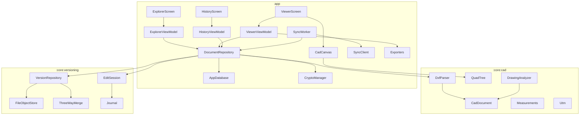
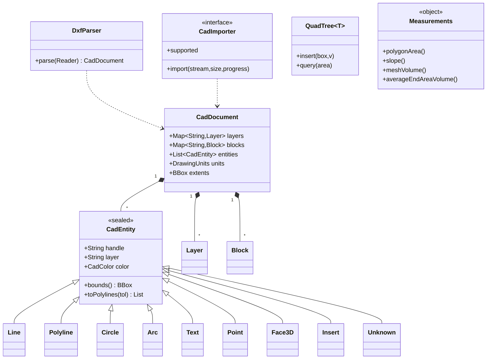
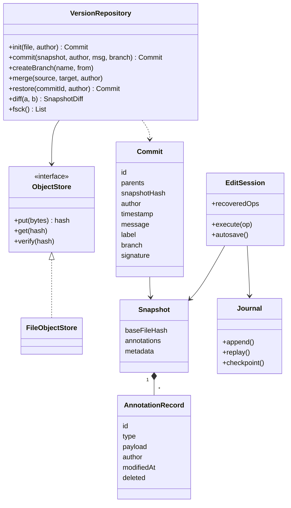
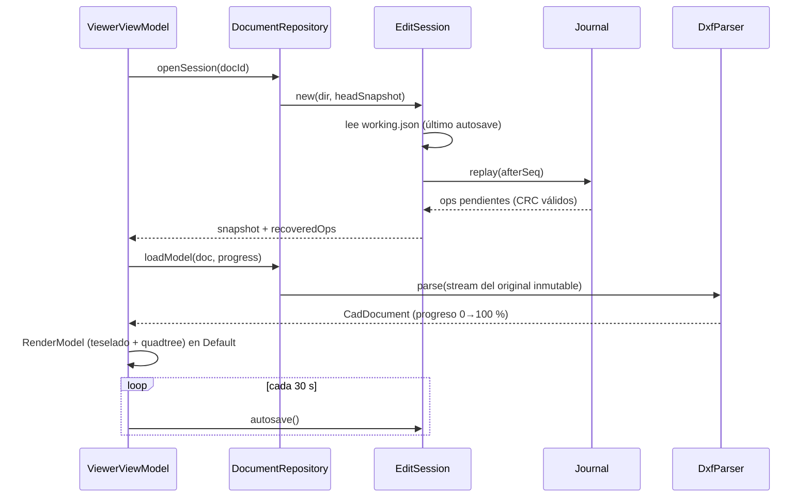
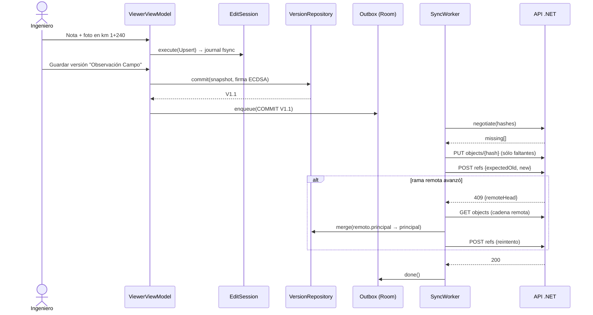
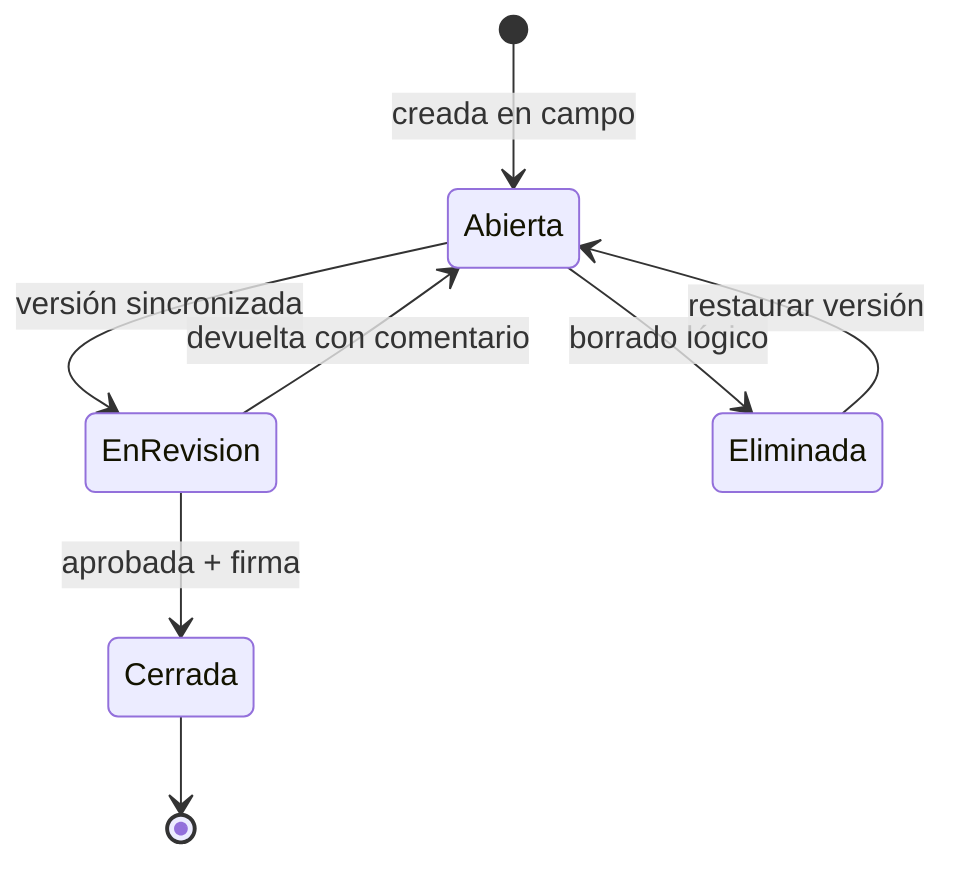
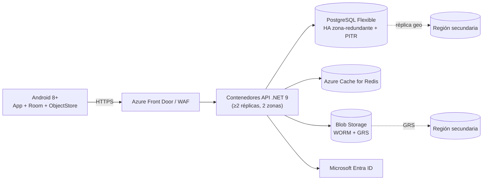

# 04 · Diagramas UML

## 1. Componentes

## 2. Clases — núcleo CAD

## 3. Clases — versionado

## 4. Secuencia — abrir plano y recuperar tras fallo

## 5. Secuencia — anotar, versionar y sincronizar

## 6. Estados de una observación

## 7. Despliegue

