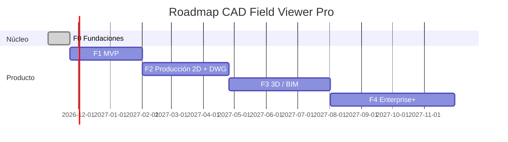

# 05 · Roadmap por fases, MVP y versión Enterprise

## 1. Fases

| Fase | Duración | Objetivo | Entregables clave | Criterio de salida |
|---|---|---|---|---|
| **F0 Fundaciones** | 3 sem | Núcleo verificable | `core/cad`, `core/versioning`, CI | **Completado en este repositorio** (25 pruebas verdes) |
| **F1 MVP** | 10 sem | Piloto de campo en 1 túnel | Visor DXF 2D, capas, mediciones, anotaciones con foto/GPS, versiones, autosave, PDF/CSV, sync con API | 20 usuarios piloto, 0 pérdidas, crash-free ≥ 99,5 % |
| **F2 Producción 2D** | 12 sem | Lanzamiento Play Store | DWG vía ODA, PDF/imagen como base, GLES, caché de teselado, login OIDC, conectores OneDrive/SharePoint | DWG 500 MB < 60 s; rating ≥ 4,3 |
| **F3 3D/BIM** | 14 sem | Modelos | Filament: OBJ/STL/glTF/GLB, IFC (web-ifc), cortes, rayos X, volumen de mallas, Drive/Dropbox | IFC 200 MB navegable a 30 fps |
| **F4 Enterprise+** | continuo | Suite de gestión técnica | Flujos de aprobación, firma avanzada, IA on-device, FBX/DGN/DWF, portal web, API pública | Contratos corporativos |

## 2. MVP (F1) — alcance cerrado

**Incluido**
- Importación (almacenamiento, correo, WhatsApp vía *intent*) con clasificación y original inmutable V1.0.
- Visor DXF 2D: zoom/pan/rotación, capas (búsqueda, agrupación, transparencia), selección y propiedades, ocultar objetos.
- Mediciones: distancia 2D/3D, polilínea, área + perímetro, pendiente %/°, ΔZ, coordenadas; snapping a vértices.
- Observaciones: texto, flecha, nube, 6 símbolos técnicos, foto; GPS + usuario + fecha.
- Versionado: guardar versión, historial, comparar, restaurar, ramas, fusión.
- Protección: journal por operación, autosave 30 s, recuperación automática.
- Exportación PDF A3 con cajetín/escala/firma + CSV (Excel).
- Sincronización diferencial con backend .NET; resolución automática con conservación de conflictos.
- Análisis geométrico básico.

**Excluido del MVP** (y por qué): DWG nativo (licencia ODA), 3D (Filament en F3), conectores OneDrive/Drive (F2), video/audio (F2), IA conversacional (F2 opcional).

**Estado del código en este repositorio:** el MVP está **implementado a nivel de código fuente**. El núcleo está probado; la app Android y la API requieren la compilación en CI y pruebas en dispositivo antes del piloto (ver `08-plan-pruebas.md`).

## 3. Versión Enterprise

| Capacidad | Community / Pro | Enterprise |
|---|---|---|
| DXF, PDF, imágenes | ✔ | ✔ |
| DWG, DGN, DWF (ODA) | Pro | ✔ |
| IFC / 3D | Pro | ✔ |
| Versionado local + ramas | ✔ | ✔ |
| Sincronización en nube | 1 GB | Ilimitada, tenant dedicado |
| SSO (Entra ID / Okta / Keycloak), SCIM | — | ✔ |
| Roles por proyecto y auditoría exportable | Básico | Completo + retención legal (WORM) |
| Firma digital con certificado corporativo (PKI) | — | ✔ |
| MDM (Intune/Workspace ONE), *managed config* | — | ✔ |
| Despliegue on-premise / nube privada | — | ✔ |
| SLA 99,9 %, soporte 24×7 | — | ✔ |
| Flujos de aprobación (RFI, NCR, liberaciones) | — | ✔ |
| Asistente IA privado (modelo en tenant) | — | ✔ |
