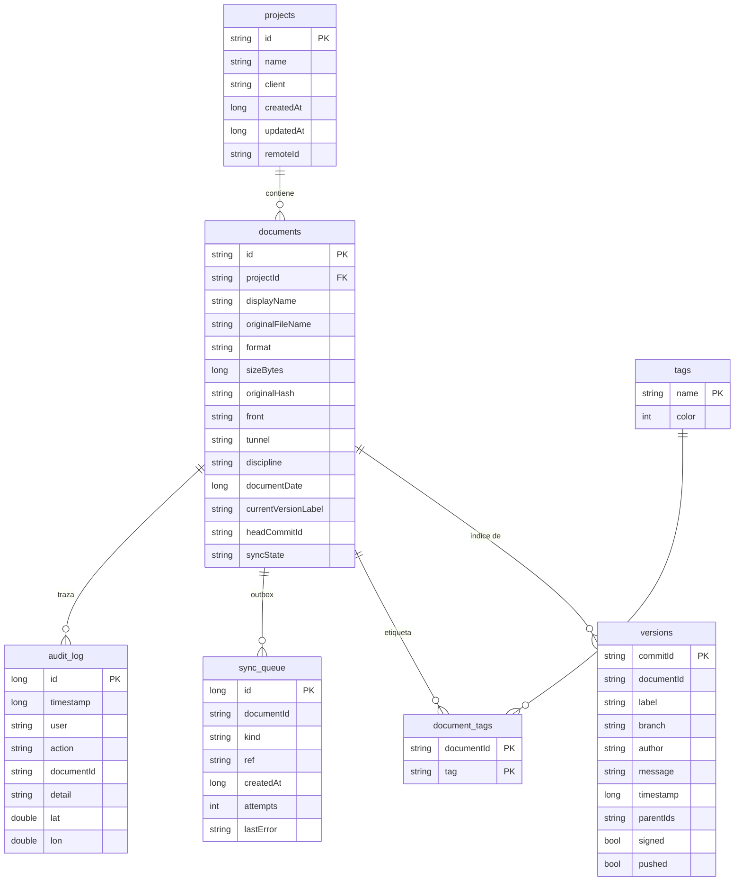
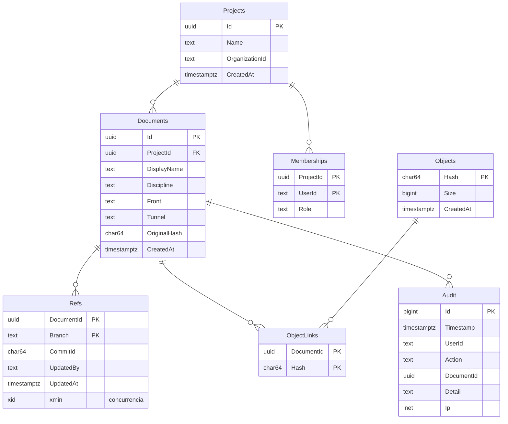

# 06 · Modelo de datos

## 1. Principio

Separación estricta entre **índice mutable** (Room/PostgreSQL: búsquedas, permisos, colas) y **contenido inmutable** (ObjectStore SHA-256: originales, snapshots, commits, multimedia). Perder o corromper el índice nunca destruye contenido: se reconstruye recorriendo `refs/` y objetos (`fsck`).

## 2. Local (Room, `cadfield.db`, WAL)



## 3. Repositorio de objetos por documento

```
files/docs/<docId>/
├── repo/
│   ├── objects/ab/cdef…   ← blobs inmutables (solo lectura en disco)
│   │     · plano original (DXF/DWG/PDF)
│   │     · snapshot JSON  {baseFileHash, annotations{}, metadata{}}
│   │     · commit JSON    {parents[], snapshotHash, author, timestamp, message, label, branch, signature}
│   │     · fotos/audio    (cifrados AES-256-GCM)
│   └── refs/
│         principal          ← id del commit cabeza (escritura atómica)
│         campo-frente-norte
│         remoto.principal   ← última cabeza remota conocida
└── session/
      working.json           ← último autosave (atómico)
      edits.wal              ← journal de operaciones (CRC32 por registro)
```

### Anotación (`AnnotationRecord.payload`)

```json
{
  "points": [{"x": 512340.12, "y": 8667420.55}],
  "text": "Filtración en hastial derecho",
  "symbol": "FILTRACION",
  "lat": -12.0461, "lon": -77.0430, "gpsAccuracyM": 4.0,
  "mediaHash": "9f2c…",
  "status": "ABIERTA"
}
```

## 4. Servidor (PostgreSQL 17)



- `Refs.xmin` → concurrencia optimista (compare-and-swap de ramas).
- `Audit`: el rol de BD de la API sólo tiene `INSERT, SELECT` (sin `UPDATE/DELETE`); particionado mensual.
- Blobs en Azure Blob/S3; la tabla `Objects` es índice + tamaño.
- Redis: caché de `refs:{docId}` (TTL 5 min, invalidación en escritura), *rate limiting*, sesiones de subida.

## 5. Migraciones

- Room: `exportSchema = true` (esquemas en `app/schemas`), **prohibido** `fallbackToDestructiveMigration`; pruebas de migración con `MigrationTestHelper`.
- EF Core: migraciones versionadas en CI; despliegue *expand → migrate → contract* sin downtime.
