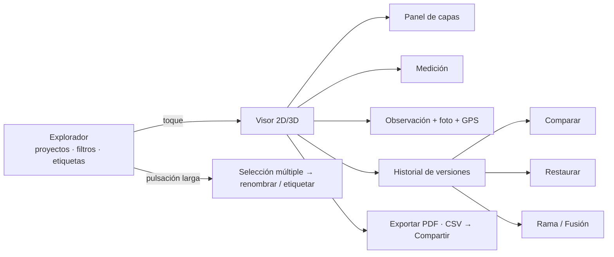

# 07 · Diseño UX/UI

## 1. Principios para trabajo de campo
1. **Una mano, con guantes**: objetivos táctiles ≥ 48 dp; herramientas en barra inferior al alcance del pulgar.
2. **Legibilidad extrema**: tema oscuro por defecto (túneles), alto contraste; ámbar de seguridad `#F2A900` como color primario.
3. **Nunca bloquear**: carga con progreso, cancelable; el plano es usable mientras termina de teselar (F2).
4. **Confianza visible**: estado de autosave, versión actual, sincronización y "cambios sin versionar" siempre visibles en la barra superior.
5. **Sin pérdida silenciosa**: si se recuperaron cambios tras un cierre, se informa ("Se recuperaron N cambios…").

## 2. Mapa de navegación



## 3. Pantallas (wireframes)

**Explorador**
```
┌──────────────────────────────────────┐
│ CAD Field Viewer Pro        ⟳(3)  ✎  │  ← sync pendiente / renombrar
│ 🔍 Buscar plano, túnel…              │
│ [+Proyecto] [Túnel L2] [Geología] …  │  ← chips de filtro
│ ▣ T2-Secciones-km1  DXF·Geología     │
│   V1.4 · 182.3 MB               ☁✓   │
│ ▣ T2-Planta-General DWG·Civil        │
│   V1.0 · 64.0 MB                ☁↑   │
│                   [ + Importar planos ]│
└──────────────────────────────────────┘
```

**Visor**
```
┌──────────────────────────────────────┐
│ ← T2-Secciones-km1        ≋  💾  ⋮   │
│   V1.4 · cambios sin versionar · auto │
│ ┌──────────────────────────────────┐ │
│ │ Área 42.318 m² · Perím 26.110 [Guardar][×]
│ │                                  │ │
│ │        (plano, gestos)           │ │
│ │                                  │ │
│ │                              [⤢] │ │  ← ajustar a extensión
│ └──────────────────────────────────┘ │
│ [✋Navegar][☝Selec][📏Dist][〰Polil][⬠Área][⛰Pend][⌖Coord][🗒Nota]… │
└──────────────────────────────────────┘
```

## 4. Gestos
| Gesto | Acción |
|---|---|
| Arrastrar 1 dedo | Pan |
| Pellizcar | Zoom centrado en los dedos |
| Girar 2 dedos | Rotación (desbloqueable desde menú para evitar giros accidentales) |
| Doble toque | Zoom ×2 en el punto |
| Toque | Acción de la herramienta activa (con *snapping* a 28 px) |
| Pulsación larga (explorador) | Selección múltiple |

## 5. Sistema visual
- Tipografía: Roboto; valores de medición en monoespaciada.
- Colores semánticos: ámbar (acción), celeste (medición), rojo (observaciones/conflicto), verde (sincronizado).
- Iconografía Material Symbols; símbolos técnicos de campo: filtración, fisura, desprendimiento, sostenimiento, punto de inspección, seguridad.
- Accesibilidad: descripciones de contenido en todos los iconos, soporte de fuente grande, contraste AA.
