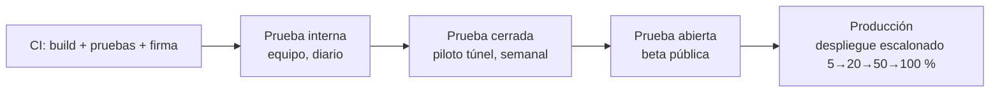

# 13 · Estrategia de despliegue en Google Play

## 1. Preparación
- `applicationId`: `com.cadfield.viewer` (registrar dominio y marca antes; nombre comercial definitivo sujeto a búsqueda de marcas — "CAD Field Viewer Pro" es provisional).
- **Android App Bundle** (`.aab`) firmado con **Play App Signing**; clave de subida en HSM/Key Vault del CI.
- `targetSdk` = último exigido por Play (35 en 2026), `minSdk 26`.
- R8 + `shrinkResources`; ABI splits automáticos del AAB (motor ODA nativo sólo `arm64-v8a`/`armeabi-v7a`).
- Play Feature Delivery: módulo dinámico `:cadengine` (ODA) y `:viewer3d` (Filament) para reducir el tamaño inicial (< 25 MB base).

## 2. Cumplimiento
| Elemento | Contenido |
|---|---|
| Data Safety | Ubicación precisa (opcional, sólo en primer plano, asociada a observaciones); fotos; identificadores de cuenta; cifrado en tránsito; eliminación de cuenta disponible |
| Política de privacidad | URL pública; tratamiento de planos como confidenciales; no se usan para entrenar IA sin consentimiento |
| Permisos | Solicitados en contexto: cámara al tomar foto; ubicación al crear observación; sin `MANAGE_EXTERNAL_STORAGE` (se usa SAF) |
| Accesibilidad | Revisión con Accessibility Scanner |
| Clasificación de contenido | Herramienta de productividad, para todos |

## 3. Canales

- Despliegue escalonado con *halt* automático si crash-rate > 1 % o ANR > 0,47 %.
- Enterprise: **Managed Google Play** (app privada o pública con *managed configurations*: URL del backend, IdP, políticas de sync) distribuida vía Intune / Workspace ONE.

## 4. ASO
- Título: "CAD Field Viewer Pro: DWG DXF" (≤ 30 car.).
- Palabras clave: visor DWG, DXF, planos, túneles, topografía, minería, mediciones, offline.
- Capturas: medición de área en sección de túnel, observación con foto/GPS, historial de versiones, modo oscuro.
- Video de 30 s: abrir plano offline → medir → anotar → versionar → exportar PDF.
- Localización: es-LATAM, es-ES, en, pt-BR.
